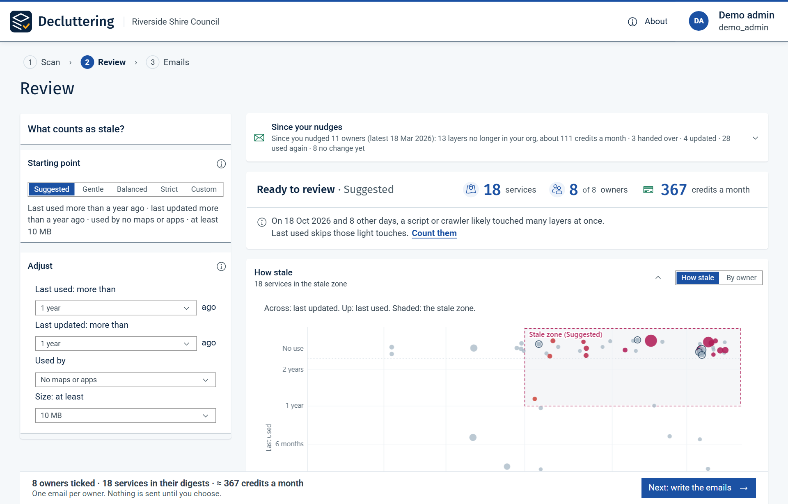
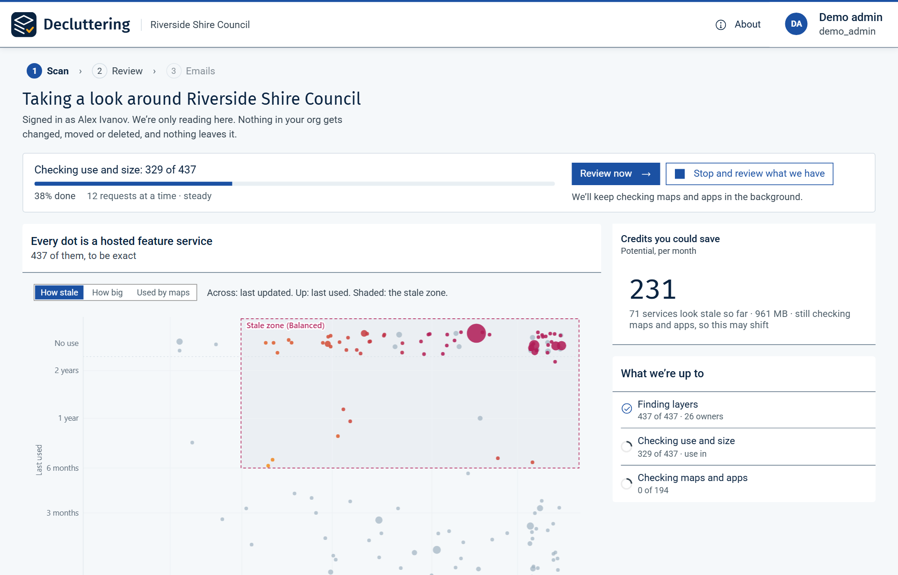
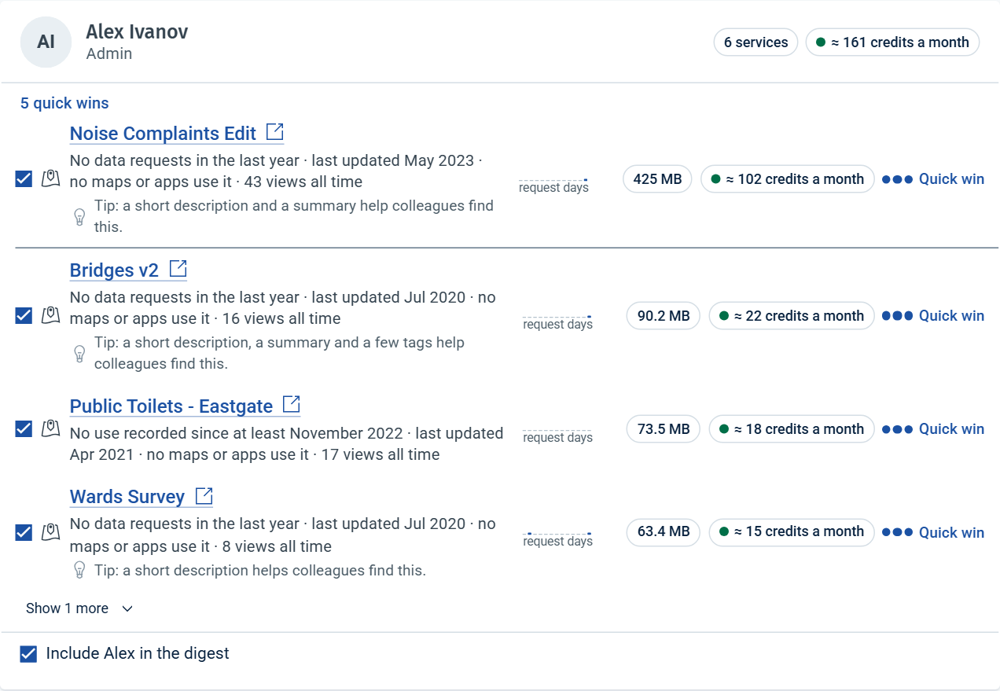
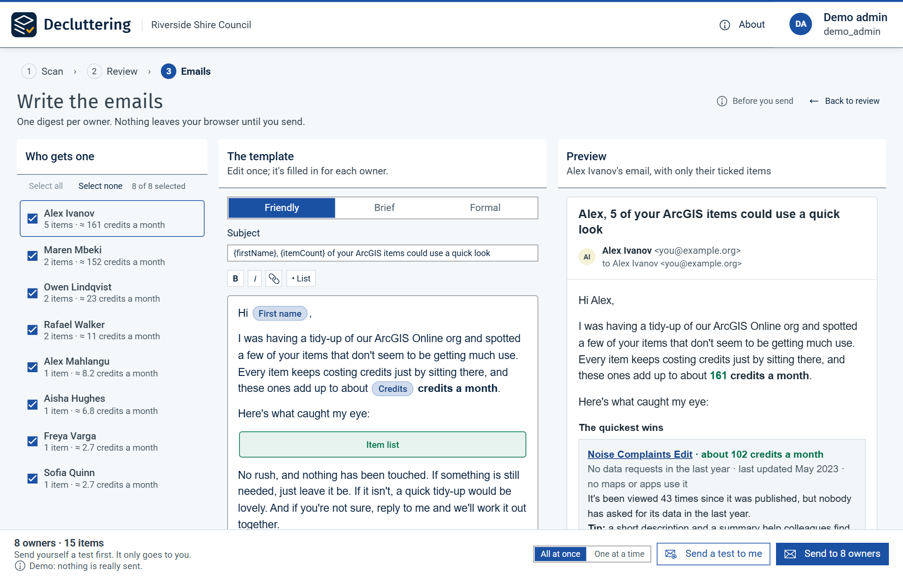
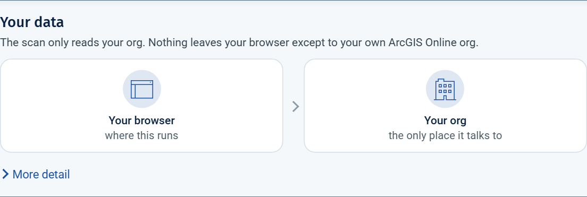

# Decluttering

**Pon orden en tu contenido de ArcGIS Online, con tacto.** [Read in English](README.md)

### [**Abrir la aplicación →**](https://aitorcalero.github.io/decluttering-web/)

Cualquier organización de ArcGIS Online que lleve unos años en marcha acumula capas de entidades alojadas que ya nadie usa: proyectos antiguos, copias de una encuesta puntual, la "v2" a la que nadie volvió. Cada una de esas capas cuesta créditos cada mes solo por existir. El administrador las ve, pero no quiere borrar el trabajo de otros. Los propietarios rara vez entran a revisarlas.

**Decluttering** se ocupa del medio de ese problema. Hace la parte lenta, que es averiguar qué capas están de verdad sin uso. Después devuelve la decisión a quien las creó, con un único correo amable. Esta versión también permite borrar con muchas salvaguardas cuando eso es lo que toca.

Este repositorio es el fork de Aitor Calero de [simongis/decluttering-web](https://github.com/simongis/decluttering-web), la aplicación original de Simon. La aplicación original está en https://simongis.github.io/decluttering-web/.

> **Pruébala sin iniciar sesión:** abre la web y elige **Probar la demo**. Reproduce el análisis completo de una organización inventada. Después puedes revisar los resultados, escribir los correos e incluso simular borrados, sin que nada salga de tu navegador.



---

## Qué es y cómo está hecha

- **Es una aplicación web que funciona entera en tu navegador.** No hay servidor de Decluttering ni base de datos externa. GitHub Pages solo sirve los ficheros de la app.
- **Habla únicamente con tu organización de ArcGIS Online.** Tus datos no pasan por ningún tercero.
- **Inicias sesión con tu cuenta de ArcGIS Online** mediante OAuth 2.0 con PKCE. No hay contraseña ni secreto que guardar.
- **Está construida con** [Calcite Design System](https://developers.arcgis.com/calcite-design-system/), [ArcGIS REST JS](https://developers.arcgis.com/arcgis-rest-js/), [Lit](https://lit.dev/), [D3](https://d3js.org/) y [Driver.js](https://driverjs.com/), sobre Vite y TypeScript.

El flujo tiene tres pasos: **Análisis → Revisión → Correos**. A ellos se suma la opción de **borrar** capas desde la revisión.

---

## 1. Análisis: solo lee



Al iniciar sesión, la app analiza tu organización:

- Todas las **capas de entidades alojadas**, con sus vistas.
- Su **tamaño**, separando el almacenamiento de entidades del de **adjuntos** (fotos, PDF y otros ficheros).
- Su **uso**, a partir de los informes de uso de ArcGIS Online y de la fecha de última visualización.
- Todos los **mapas web y aplicaciones**, para saber qué capas utiliza cada uno.

Mientras analiza, una gráfica dibuja cada capa como un punto. El eje horizontal indica cuánto hace que se actualizó y el vertical cuánto hace que se usó. La **zona sombreada** es la zona "sin uso reciente".

Detalles prácticos del análisis:

- **Puedes abrir la revisión en cuanto llegan los datos básicos.** Los mapas y aplicaciones se siguen comprobando en segundo plano.
- **Las organizaciones grandes** (miles de capas) tardan más. Un análisis detenido **se puede reanudar** donde se quedó.
- **El último análisis se guarda en el navegador**, así que al volver no hay que empezar de cero. La app te avisa cuando conviene volver a analizar.
- **Mientras se analiza se muestran consejos** sobre ArcGIS Online.
- **El análisis no puede escribir nada.** Cada petición pasa por una lista de permitidos que solo deja leer.

---

## 2. Revisión: ves exactamente por qué

### La regla

Una capa aparece en la lista solo si se cumplen **las cuatro condiciones** de la regla:

1. **Último uso** hace más de N.
2. **Última actualización** hace más de N.
3. **La usan como máximo** N mapas o aplicaciones.
4. **Tiene al menos** el tamaño mínimo.

Todos los valores se ven y se pueden cambiar. Para no empezar de cero hay **puntos de partida**:

| Punto de partida | Último uso | Última actualización | Usado por | Tamaño |
|---|---|---|---|---|
| **Suave** | más de 1 año | más de 1 año | ningún mapa ni aplicación | 20 MB o más |
| **Equilibrado** | más de 6 meses | más de 6 meses | como máximo 1 | 15 MB o más |
| **Estricto** | más de 3 meses | más de 3 meses | como máximo 2 | 10 MB o más |
| **Sugerido** | se calcula para tu organización: la configuración más suave que deja una lista manejable | | | |

Por defecto se excluyen los elementos marcados como **fidedignos**. Los marcados como **obsoletos** se incluyen, y puedes cambiar ambas opciones.

### Qué significa "último uso"

El último uso es la fecha más reciente de dos que guarda ArcGIS Online, contando la capa y sus vistas:

- Cuándo se abrió por última vez: su página, Map Viewer, o un mapa o aplicación que la usa.
- El último día en que algo solicitó sus datos, incluidos scripts.

La app descarta los días en que un rastreador tocó cientos de capas a la vez, para que no cuenten como uso real. Además, ante la duda, la app supone que la capa **sí se usa**: una capa cuyo uso no se pudo leer entero **nunca** entra en la lista.

### Cuánto cuesta cada capa

Para cada capa, la app estima cuántos **créditos al mes** cuesta mantenerla:

- **Los datos** cuentan como almacenamiento de entidades: 2,4 créditos por cada 10 MB al mes.
- **Los adjuntos** cuentan como almacenamiento de archivos, que es mucho más barato: 1,2 créditos por GB al mes.

Una capa llena de fotos muestra su tamaño total, pero su coste en créditos es menor. Si pasas el ratón sobre la cifra, ves qué parte corresponde a adjuntos. Son estimaciones; lo facturado de verdad está en Organización › Estado › Almacenamiento.

### Prioridad

Cada capa lleva una etiqueta de prioridad: **Mejora rápida**, **Conviene revisar** o **Impacto bajo**. También puede llevar un **consejo**, por ejemplo agregar una descripción o etiquetas para que el equipo la encuentre. Si algún mapa o aplicación la usa, sale marcada **Ordenar con cuidado**.



### La gráfica de la revisión

La gráfica de la revisión hace bastante más que mostrar los puntos:

- **Dos vistas:** "Tiempo sin uso" y "Por propietario".
- **Escala vertical "Logarítmica, en semanas".** Casi todas las capas se usaron en las últimas semanas y en la escala normal se amontonan junto a "hoy". La escala logarítmica las separa en 1, 2, 4, 13, 26, 52 y 104 semanas. La elección se recuerda.
- **Interruptor Seleccionar | Ampliar.**
  - En modo **Ampliar**, arrastras un rectángulo y esa zona llena la gráfica, con etiquetas de los ejes más finas. Puedes volver a ampliar dentro de la ampliación.
  - **Atrás** deshace una ampliación y **Ver todo** vuelve a la gráfica completa.
  - En modo **Seleccionar**, el rectángulo elige capas para borrar.
- **Por qué la zona sombreada tiene más capas que la lista.** La zona solo usa dos condiciones de la regla, último uso y última actualización, mientras que la lista exige las cuatro. Una línea bajo la gráfica explica el desfase, por ejemplo "168 capas en la zona, 0 en la lista: 168 de menos de 10 MB, 9 usadas por más de 2 mapas".
  - Un motivo frecuente es **último uso desconocido**. El análisis lee un año de uso y ArcGIS Online no guarda una fecha de última visualización antigua. Con una regla de más de un año, la app no puede afirmar que la capa lleve tanto tiempo sin usarse, así que la deja fuera.
- **Capas pequeñas.** En organizaciones con más de 150 capas, la gráfica no dibuja las de menos de 3 MB, salvo que pidas verlas.
- **Diagrama de flujo (sankey).** Muestra cómo se reparten las capas y los créditos. Al hacer clic en una banda se filtra la lista.

### Elegir un propietario

La lista **Propietario** incluye a todos los propietarios de la organización, también a los que no tienen capas en la lista. Al elegir uno, la gráfica muestra todas sus capas, cumplan o no la regla, para que puedas seleccionarlas con un rectángulo. La lista muestra solo su tarjeta. Si ninguna de sus capas cumple la regla, la app lo dice y te indica cómo seleccionarlas en la gráfica.

### La historia de cada capa

Cada fila muestra barras de uso mensual de un año. Al hacer clic se abre un panel con:

- **Los días en que se solicitaron sus datos,** en forma de calendario o de barras mensuales, a 12 meses o 2 años.
- **Todo lo que la usa:** sus vistas, los mapas y aplicaciones que la usan directamente o a través de un mapa, las **áreas de mapa sin conexión** y los **formularios de Survey123**.
- **Un enlace a su página** en ArcGIS Online.

Abrir este panel no gasta créditos ni cuenta como uso.


### Capas que faltan

La app también señala los **mapas y aplicaciones que apuntan a capas que ya no existen** en tu organización. Conviene arreglarlos decidas lo que decidas con el resto.

### Si no eres administrador

Cualquier usuario puede entrar. Sin rol de administrador, la app revisa **tus propias capas** y puedes ir marcándolas como ordenadas. Si eres el único propietario de la organización, te muestra tu lista ordenada de mayor a menor. Además, te ofrece copiar una nota para tu administrador, por si quiere usar la herramienta con todo el equipo.

### Quién puede hacer qué

Tras iniciar sesión, una lista de comprobación indica qué permite tu cuenta:

| Puedes | Necesitas |
|---|---|
| Revisar toda la organización | rol de administrador que vea todos los elementos y miembros (`portal:admin:viewItems`, `portal:admin:viewUsers`) |
| Ver el "último uso" | acceso a los informes de uso de la organización |
| Enviar avisos | crear grupos y agregar miembros a grupos (`portal:user:createGroup`, `portal:admin:assignToGroups`) |
| Revisar tus propias capas | cualquier cuenta |

Si tu organización solo permite **aplicaciones aprobadas** (Organización › Configuración › Seguridad › Aplicaciones aprobadas), un administrador tiene que agregar Decluttering a esa lista primero.

---

## 3. Correos: un solo correo resumen por propietario



### Quién recibe correo

En la revisión, cada tarjeta de propietario tiene:

- En cada capa, a la izquierda, **una casilla con un sobre**. Marcada significa que esa capa va en su correo.
- Al pie de la tarjeta, **"Incluir a [nombre] en el correo resumen"**, que marca o desmarca todas sus capas. Al lado se ve cuántas capas lleva su correo.

Una línea encima de las tarjetas lo explica. Si un propietario no tiene nada marcado, su tarjeta indica que no recibirá correo. Si la lista está vacía con la regla actual, no hay nada que marcar: relaja la regla en el panel de la izquierda.

### Escribir el correo

- **Tres tonos:** Cercano, Breve y Formal.
- **Editor sencillo** con negrita, cursiva, enlaces y listas.
- **Marcadores** que se rellenan para cada propietario: Nombre, Número de elementos, Créditos, Lista de elementos y Tu nombre.
- **Vista previa en directo** de lo que recibirá cada propietario:
  - Solo sus capas marcadas, con enlace a cada una.
  - Primero las mejoras más rápidas.
  - El motivo de cada capa, los créditos que liberaría y una frase de contexto, como "Se ha visualizado 1109 veces desde que se publicó, pero nadie la ha usado desde noviembre de 2025".
- **Avisos al escribir:** si quitas la lista de elementos, o si agregas un enlace que ArcGIS Online podría rechazar.
- **Idioma del correo.** Se elige en el mismo paso y empieza con el idioma de la app. Todo el correo cambia de idioma: plantilla, lista, fechas, números y pie. Si ya habías editado la plantilla, la app pide confirmación antes de sustituirla.

### Cómo se envía

ArcGIS Online solo envía notificaciones a miembros de un grupo. Por eso Decluttering usa **un único grupo oculto**, solo por invitación y visible solo para ti. Pregunta antes de crearlo, lo reutiliza en cada envío y puedes eliminarlo cuando quieras. Para cada propietario:

1. Lo agrega al grupo.
2. Envía la notificación con su correo.
3. Lo quita del grupo.

Entre envíos, el grupo queda vacío.

### Salvaguardas del envío

- **El envío lo activa cada administrador para sí mismo**, dentro de la app: en la lista de comprobación tras iniciar sesión, **Envío en esta organización** › **Activar el envío**.
- **Primero te envías una prueba.** El envío a propietarios no se desbloquea hasta que tu prueba ha salido bien en esa sesión. Así, el correo que revisas es exactamente el que se envía.
- **Nada sale sin confirmar.** Puedes enviar todos a la vez o **uno por uno**.
- **Límites:**
  - Como máximo 40 propietarios por envío y 100 al día, con un par de segundos entre correos.
  - El envío se para con el primer error de ArcGIS. Te dice cuántos se enviaron y quién falta, y ofrece **Reanudar**.
- **Descanso de seis meses.** Un propietario avisado no vuelve a salir marcado por defecto hasta pasados seis meses, contando los avisos de todos los administradores. Puedes marcarlo igualmente si hace falta.
- **Registro de avisos (opcional).** Es una tabla alojada en tu propia organización que guarda a quién se avisó, cuándo y de qué elementos, nunca el texto del mensaje.
- **"Desde tus avisos".** Más adelante, la app muestra qué pasó con las capas avisadas: cuáles se eliminaron, cambiaron de propietario, se actualizaron o se volvieron a usar, y cuántos créditos se ahorraron.
- **Desactivar el envío** (en la misma fila de la lista de comprobación, o en Acerca de) elimina tu grupo oculto. El registro de avisos se conserva, así que los propietarios avisados siguen en su descanso.

---

## 4. Borrar capas (desactivado salvo que la compilación lo active)


A veces lo correcto es borrar: copias antiguas, proyectos abandonados o capas que ocupan mucho. Una compilación con `VITE_DELETING=on` permite borrar desde la revisión con tu propia cuenta. La web de este fork lo tiene activado. Cualquier otra compilación nunca ofrece ni envía un borrado.

### Cómo se eligen las capas

- **En la gráfica:**
  - Arrastra un rectángulo y todas las capas dentro se agregan a la selección, **cumplan o no la regla**.
  - Cada rectángulo dice cuántas agregó y cuántas dejó fuera porque no puedes borrarlas.
  - Las capas seleccionadas llevan un anillo rojo.
  - Si el rectángulo cubre capas pequeñas que no se dibujan, la app lo dice y ofrece **Incluirlas**.
- **Clic en un punto:** ofrece Ver elemento, Agregar a la selección o Quitar de la selección, y Borrar. Con el teclado, las flechas mueven entre puntos, Enter abre el menú y Escape lo cierra.
- **En la lista:** cada fila tiene **Seleccionar para borrar** y un botón **Borrar…**. Arriba están **Seleccionar todas para borrar**, el recuento de capas y almacenamiento seleccionados, **Quitar la selección** y **Borrar seleccionadas…**.
- **En el panel de una capa:** el botón **Borrar…**.

La selección para borrar es independiente de las casillas del correo.

### Qué te protege


- **Confirmación cada vez.** El diálogo:
  - Lista cada capa con su propietario, su tamaño y las vistas que se borran con ella.
  - Permite **Quitar** cualquiera de ellas de este borrado.
  - Avisa si algún mapa o aplicación la usa.
  - Indica qué cuenta hace el borrado.
  - Te pide escribir `BORRAR`.
- **Nunca es un borrado permanente.** La app envía un borrado normal, así que se aplica la papelera de reciclaje donde la organización la tiene. Las capas con protección contra borrado se saltan y se informan.
- **Se comprueba justo antes.** La app vuelve a leer cada capa y la salta si ya no es una capa alojada, si cambió de propietario o si está protegida.
- **Solo con el análisis completo.** Seleccionar y borrar se activan cuando ya se comprobaron todos los mapas y aplicaciones, para que "usado por" sea fiable.
- **Deciden tus privilegios.** Con el privilegio de crear, actualizar y eliminar contenido (`portal:user:createItem`) puedes borrar tus capas. Con el de eliminar elementos (`portal:admin:deleteItems`), las de cualquiera. ArcGIS Online aplica sus propias reglas igualmente.
- **Su propia lista de permitidos.** El borrado solo puede hacer dos llamadas: leer el elemento y borrarlo.
- **Informe CSV.** Al terminar puedes descargar una fila por capa con cuándo, quién, propietario, tamaño, vistas, resultado y motivo. ArcGIS Online no avisa a los propietarios cuando un administrador borra sus capas, así que el informe sirve de registro o para avisarles tú. El texto que una hoja de cálculo podría ejecutar como fórmula se neutraliza.

El diseño está en la [ADR 0016](docs/adr/0016-deleting-layers.md) y el plan de pruebas manual para una organización real en [docs/testing/deleting.md](docs/testing/deleting.md).

---

## Idiomas

- **La app está en inglés y en español.** Sigue tu idioma de ArcGIS Online, y puedes cambiarlo en el menú de usuario.
- **Los correos se escriben en el idioma que elijas** en el paso Correos.
- **Todo el texto vive en catálogos por idioma.** Un idioma nuevo solo necesita traducir sus ficheros, sin tocar código (ver `CONTRIBUTING.md`, "Translating the app"). Un test comprueba que cada idioma tiene las mismas claves y los mismos marcadores. El español además tiene un [glosario](docs/i18n/glossary-es.md): por ejemplo, "ordenar" en vez de "limpiar", y "sin uso reciente" en vez de "obsoleto", que es el término de Esri para Deprecated.

---

## Otras comodidades

- **Recorrido guiado** de la primera visita.
- **Aspecto "consola" opcional,** retro y con gráficas a juego, que se activa con un interruptor junto a Acerca de.
- **Versión visible en la cabecera,** por ejemplo `v1.4.0-dev.13 · 0633325 · borrado activado`.
- **Aviso de nueva versión.** Cuando se publica una versión nueva, la app ofrece **Recargar**, nunca de forma automática, para no cortar un análisis, un envío o un borrado. La primera carga de una versión nueva descarta el análisis guardado por la anterior.
- **Página Acerca de** con lo que guarda la app y dónde, y botones para eliminar el grupo oculto o el registro de avisos.
- **Accesibilidad:** navegación con teclado, también por los puntos de la gráfica, foco gestionado en los diálogos y tests automáticos de accesibilidad.

---

## Seguridad y privacidad



- **Sin servidor propio.** El análisis y la configuración se quedan en tu navegador, y puedes borrarlos desde el menú de usuario.
- **El token de sesión** vive solo en la pestaña, viaja en cabeceras (nunca en la dirección web) y se revoca al cerrar sesión.
- **Cada escritura tiene su propia lista de permitidos:**
  - El análisis solo puede leer.
  - El envío solo puede tocar el grupo oculto de la app.
  - El registro solo puede agregar filas a su propia tabla.
  - El borrado solo puede leer un elemento y borrarlo.
- **Política de seguridad de contenido (CSP) estricta:** solo se ejecutan scripts del propio sitio, los datos solo van a `*.arcgis.com` y no se permiten iframes.
- **No se puede meter en un iframe.** La app no arranca dentro del iframe de otra web, para que nadie pueda engañarte para hacer clic en Enviar o Borrar.
- **La plantilla del correo solo conserva formato básico.** Se eliminan scripts, imágenes, estilos y enlaces peligrosos, aunque se arrastren al editor.
- **Despliegue:** las acciones de GitHub están fijadas a un commit, los paquetes publicados se auditan antes de cada despliegue y Dependabot propone actualizaciones.

Más detalles en `SECURITY.md`.

---

## Montar tu propia copia

Requisitos: Node 22.

```
npm ci
cp .env.example .env      # y rellena VITE_ARCGIS_CLIENT_ID
npm run dev               # http://localhost:5173
```

1. **Registra la app en ArcGIS Online.** Contenido › Nuevo elemento › Credenciales de desarrollador › Credenciales OAuth 2.0. Agrega las URL de redirección `http://localhost:5173/` y la de tu web (por ejemplo `https://<tú>.github.io/decluttering-web/`), exactas y con la barra final. Pon el client ID en `VITE_ARCGIS_CLIENT_ID`. Es público por diseño; no hay secreto.
2. **Elige dónde se puede enviar** con `VITE_SENDING`: vacío u `off` (solo revisión), `list` (solo las organizaciones de `VITE_WRITABLE_ORG_IDS`) u `opt-in` (cualquier organización; cada administrador lo activa para sí mismo).
3. **Si quieres, activa el borrado** con `VITE_DELETING=on`. Vacío o cualquier otro valor lo deja desactivado.

`npm run dev` siempre usa el puerto 5173 y se para con un error si está ocupado, en vez de pasar al 5174, donde el inicio de sesión fallaría con *Invalid redirect_uri*.

Comprobaciones: `npm run typecheck && npm run lint && npm test && npm run e2e`. `npm run clean` elimina todas las compilaciones y resultados de tests.

### Publicar en GitHub Pages

`.github/workflows/deploy-pages.yml` comprueba (tipos, lint, tests, auditoría de paquetes), compila y publica en cada push a `main`.

1. Settings › Pages › Source: **GitHub Actions**.
2. Settings › Secrets and variables › Actions › **Variables**:
   - `VITE_ARCGIS_CLIENT_ID` (obligatoria)
   - `VITE_SENDING` (opcional: `off`, `list` u `opt-in`; sin definir equivale a `off`)
   - `VITE_DELETING` (opcional: `on` permite borrar capas desde la revisión; sin definir equivale a desactivado)

---

## Aviso, contribuciones y licencia

La aplicación se ofrece tal cual, sin garantías: consulta [Disclaimer](README.md#disclaimer) en el README en inglés. Las ideas, comentarios y colaboraciones son bienvenidos; si algo no cuadra, [abre una incidencia](https://github.com/aitorcalero/decluttering-web/issues). La guía para contribuir está en `CONTRIBUTING.md` y la licencia en [Licence](README.md#licence).

Este documento es la versión en español del [README](README.md). Si cambias el comportamiento de la app, actualiza los dos.
